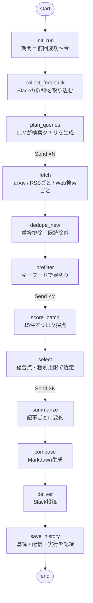

# news-digest-agent

ユーザのロールと興味を設定（`profile.yaml`）すると、論文・ニュース・ブログ・SNSから前回実行以降の新着情報を集め、**関連度・実務への応用性・インパクト**の観点で採点し、重要なものだけを要約して Markdown と Slack に届ける LangGraph アプリ。Slack の評価（👍/👎）が次回の採点に反映される。ローカル実行のみを想定。

## グラフ



点線は Send API による並列の分岐。

## セットアップ

```bash
uv sync
cp .env.example .env    # LLM・Tavily・Slack のキーを設定
```

| 変数 | 必須 | 内容 |
|---|---|---|
| `LLM_FAST` / `LLM_STANDARD` | ○ | `provider:model`。既定は Anthropic（`ANTHROPIC_API_KEY` が必要）。`ollama:qwen3:8b` などローカルも可 |
| `TAVILY_API_KEY` | | Web検索。未設定ならスキップ（無料枠 1,000クレジット/月） |
| `SLACK_BOT_TOKEN` / `SLACK_CHANNEL_ID` | | 推奨。記事ごとに投稿し、リアクションでフィードバックを集める |
| `SLACK_WEBHOOK_URL` | | Bot の代わりの簡易投稿（フィードバック不可） |

### Slack App の作り方

1. <https://api.slack.com/apps> → Create New App → From scratch
2. OAuth & Permissions → Bot Token Scopes に `chat:write` と `reactions:read` を追加 → Install to Workspace
3. 表示された `xoxb-...` を `SLACK_BOT_TOKEN` に設定
4. 投稿先チャンネルで `/invite @アプリ名`。チャンネルIDはチャンネル詳細の最下部（`C...`）を `SLACK_CHANNEL_ID` に設定

## 使い方

```bash
# まずは履歴を更新せずに試す（何度でもやり直せる）
uv run digest run --dry-run --no-slack -v

# 本番実行（前回実行以降の新着 → Markdown 出力 → Slack 投稿 → 既読に記録）
uv run digest run

# オンデマンドで期間を指定（JST として解釈）
uv run digest run --since 2026-10-20

# フィードバック（IDはダイジェストに表示される8文字）
uv run digest feedback 3f9a1c2e up --note "実装の参考になった"
uv run digest feedback 7b2d0e11 down --note "製品の宣伝"

# 実行履歴
uv run digest history
```

出力は `output/digests/YYYY-MM-DD_HHMM.md`、履歴DBは `data/history.sqlite3`。

### 定期実行（macOS）

```bash
./scripts/install_launchd.sh          # 毎日 07:30
./scripts/install_launchd.sh 6 45     # 毎日 06:45
./scripts/install_launchd.sh uninstall
```

スリープで時刻を逃しても、復帰後に1回実行される。ログは `logs/`。

### LangGraph Studio でデバッグ

```bash
uv run langgraph dev
```

ブラウザで `https://smith.langchain.com/studio/?baseUrl=http://127.0.0.1:2024` が開く（LangSmith の無料アカウントでログイン）。Safari はローカルへの接続をブロックするので、Chrome を使うか `uv run langgraph dev --tunnel` で起動する。

入力（Input）は次のようにする。`dry_run` を付けないと既読DBが更新され、本番の次回実行から記事が消える。

```json
{"dry_run": true, "post_to_slack": false}
```

| やりたいこと | Studio での操作 |
|---|---|
| 各ノードの出力を見る | 実行後、左のグラフでノードを選ぶ（`fetch` は Send の分岐ごとに出る） |
| 採点の直前で止める | Interrupt で `select` の前にブレークポイント → `scored` を確認して Continue |
| 取得をやり直さずに採点だけ試す | `prefilter` の前のチェックポイントから Fork し、`candidates` を編集して再実行 |
| プロファイル・プロンプトを調整 | `profile.yaml` を保存 → 次の実行（Fork を含む）に反映。`.py` の変更はサーバーが自動で再読み込み |
| 期間を変える | 入力に `"since_override": "2026-10-20"`（タイムゾーンなしは JST） |

LLM の呼び出し内容（プロンプト・構造化出力）まで見たい場合は、`.env` に `LANGSMITH_API_KEY` と `LANGSMITH_TRACING=true` を設定するとトレースが LangSmith に送られる。

## カスタマイズ

すべて `profile.yaml` で行う。

- **ロール・興味**: `role` / `context` / `interests`。採点とクエリ生成の基準になる
- **事前フィルタ**: `keywords`（加点）/ `exclude`（除外）
- **「重要」の重み**: `weights`（関連度・応用性・インパクト）
- **掲載基準**: `selection.min_score` / `top_k` / `max_per_source_type`
- **情報源**: `sources.rss.feeds` にフィードを追加、`sources.arxiv.categories` で分野を絞る

## ディレクトリ構成

```
.
├── profile.yaml        # ロール・興味・重み・情報源の設定
├── langgraph.json      # LangGraph Studio の設定
├── src/news_digest/
│   ├── cli.py          # `digest` コマンド
│   ├── app.py          # 依存（Deps）の組み立てと実行
│   ├── graph.py        # LangGraph のノードと配線
│   ├── config.py       # 設定・プロファイルの読み込み
│   ├── models.py       # データモデル
│   ├── processing.py   # 重複排除・事前フィルタ・総合点（純粋関数）
│   ├── prompts.py      # LLM プロンプト
│   ├── llm.py          # チャットモデルの生成
│   ├── store.py        # SQLite の履歴（既読・実行・フィードバック）
│   ├── textutil.py     # URL 正規化・テキスト処理
│   ├── studio.py       # LangGraph Studio 用の入口
│   ├── sources/        # 情報源（arXiv / RSS / Tavily）
│   └── delivery/       # 配信（Markdown / Slack）
├── tests/              # 偽LLM・MockTransport によるテスト
├── docs/               # 要件・設計判断
├── scripts/            # 定期実行（launchd）の設定
├── data/               # 履歴DB（history.sqlite3）
└── output/digests/     # 生成したダイジェスト（Markdown）
```

## 開発

```bash
uv run pytest
uv run ruff check . && uv run ruff format --check .
uv run pyright
```

要件は [docs/requirements.md](docs/requirements.md)、設計判断は [docs/decisions.md](docs/decisions.md)。

## ロードマップ

| フェーズ | 内容 | 状態 |
|---|---|---|
| 1–2 | arXiv＋RSS＋Web検索、Send による並列化、既読DB、Markdown/Slack、フィードバック | ✅ |
| 3 | 評価セット（手でラベル付けした記事）で採点精度を計測、埋め込みによる事前フィルタ | |
| 4 | LangSmith でトレース、取得元の追加（GitHub Releases、Hugging Face Papers など） | |
| 5 | フィードバックからのプロファイル自動更新、Web UI | |
